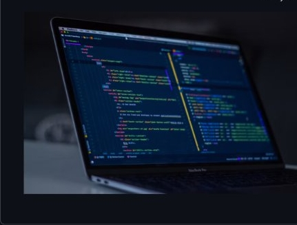
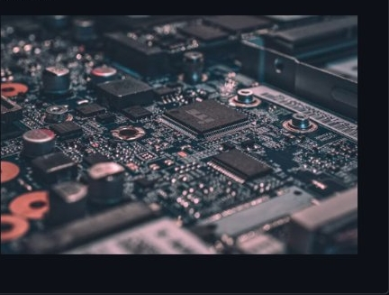

  <!-- ══════════════════════════════════════════════════════════ -->
  <!--                 01. PERSONAL WORKSPACE HEADER              -->
  <!-- ══════════════════════════════════════════════════════════ -->
  

    

  <!-- ══════════════════════════════════════════════════════════ -->
  <!--                 02. QUICK CONNECT & PROFILE VIEWS          -->
  <!-- ══════════════════════════════════════════════════════════ -->
  

    
    &nbsp;
    
    &nbsp;
    
    &nbsp;
    
  

   

  <!-- ══════════════════════════════════════════════════════════ -->
  <!--                 03. ABOUT / BEHIND THE CODE                -->
  <!-- ══════════════════════════════════════════════════════════ -->
  

    

  <!-- ══════════════════════════════════════════════════════════ -->
  <!--                 04. FLAGSHIP ARCHITECTURES                 -->
  <!-- ══════════════════════════════════════════════════════════ -->
  <h2 align="center">Featured Systems</h2>
  
<em>Autonomous agent governance, human-in-the-loop decision engines & multi-agent compliance</em>

 

<!-- PROJECT 1: SENTINELMESH -->
<table width="100%">
  <tr>
    <td width="100%">
      

        <h3>🛡️ SentinelMesh &nbsp;<code>v1.0</code></h3>
        
<b>AI Agent Governance Platform</b> — Security, runtime observation & deterministic policy restraint for multi-agent systems.

        

          
          
          
          
        

<pre><code>AI AGENT RUNTIME ──► RUNTIME OBSERVE ──► INTENT REASONING ──► POLICY ENGINE ──► VERIFIED ACTION
        │                                                                              ▲
        └──────────────────────── [QUARANTINE TRIGGER] ────────────────────────────────┘</code></pre>
        

          
        

      

    </td>
  </tr>
</table>

 

<!-- PROJECT 2: PROOFPILOT -->
<table width="100%">
  <tr>
    <td width="100%">
      

        <h3>⚡ ProofPilot &nbsp;<code>v1.0</code></h3>
        
<b>Human-Governed AI Decision Workspace</b> — Multi-criteria evaluation allowing AI agents to examine evidence and simulate tradeoffs while keeping final execution strictly under human audit.

        

          
          
          
          
        

<pre><code>INVESTIGATE EVIDENCE ──► WEIGH TRADEOFFS ──► EVALUATE RISK ──► HUMAN APPROVAL ──► STATE UPDATE
        │                                                                              ▲
        └────────────────────── [DETERMINISTIC VERIFICATION] ──────────────────────────┘</code></pre>
        

          
        

      

    </td>
  </tr>
</table>

 

<!-- PROJECT 3: GRANTGUARDIAN -->
<table width="100%">
  <tr>
    <td width="100%">
      

        <h3>📜 GrantGuardian &nbsp;<code>v1.0</code></h3>
        
<b>Multi-Agent Research &amp; Citation Integrity SaaS</b> — Autonomous research-governance engine detecting 2nd-order citation rot, quarantining compromised studies, and generating cryptographic compliance audits.

        

          
          
          
          
        

<pre><code>PROPOSAL INGESTION ──► CITATION GRAPH SCAN ──► ROT DETECTION ──► QUARANTINE ──► CRYPTO AUDIT
        │                                                                              ▲
        └─────────────────────── [AUTONOMOUS COMPLIANCE GUARD] ────────────────────────┘</code></pre>
        

          
        

      

    </td>
  </tr>
</table>

 

  <!-- ══════════════════════════════════════════════════════════ -->
  <!--                 05. TECH STACK (SQUIRCLE GRID)             -->
  <!-- ══════════════════════════════════════════════════════════ -->
  <h3 align="center">Tech stack</h3>

  

    
  

  

    
  

   

  <!-- ══════════════════════════════════════════════════════════ -->
  <!--                 06. WORDS TO BUILD BY (QUOTE)              -->
  <!-- ══════════════════════════════════════════════════════════ -->
  

    

  <!-- ══════════════════════════════════════════════════════════ -->
  <!--                 07. FOOTER & CYBERPUNK HARDWARE/CODE       -->
  <!-- ══════════════════════════════════════════════════════════ -->
  

    <em>curiosity on. build mode on.</em>
  

  

    
    &nbsp;
    
  

