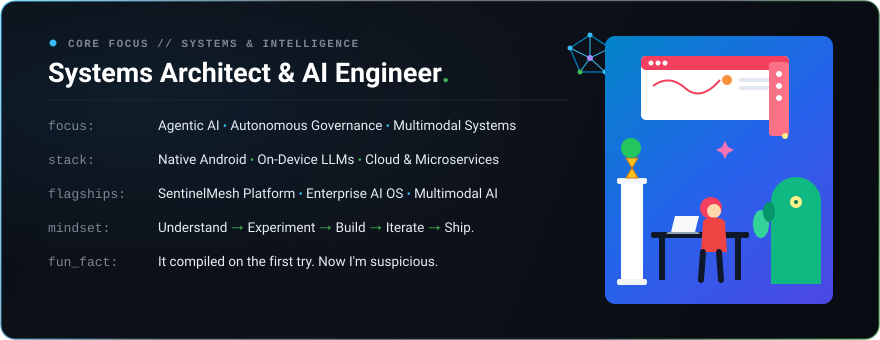
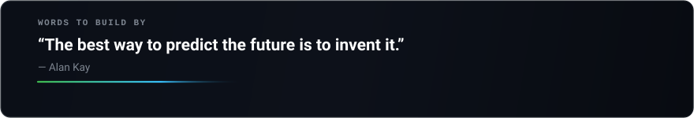

  <!-- ══════════════════════════════════════════════════════════ -->
  <!--                 01. PERSONAL WORKSPACE HEADER              -->
  <!-- ══════════════════════════════════════════════════════════ -->
  

    

  <!-- ══════════════════════════════════════════════════════════ -->
  <!--                 02. QUICK CONNECT & PROFILE VIEWS          -->
  <!-- ══════════════════════════════════════════════════════════ -->
  

    
    &nbsp;
    
    &nbsp;
    
    &nbsp;
    
  

   

  <!-- ══════════════════════════════════════════════════════════ -->
  <!--                 03. ABOUT / BEHIND THE CODE                -->
  <!-- ══════════════════════════════════════════════════════════ -->
  

    

  <!-- ══════════════════════════════════════════════════════════ -->
  <!--                 04. FLAGSHIP ARCHITECTURES                 -->
  <!-- ══════════════════════════════════════════════════════════ -->
  <h3 align="center">Featured Systems</h3>
  
<em>Production-grade agent governance, multimodal perception & enterprise automation</em>

<table>
  <tr>
    <td width="33%" valign="top">
      <h4>🛡️ SentinelMesh</h4>
      
<b>AI Agent Governance Platform</b> Security, runtime observation & control protocol for autonomous agentic workflows.

      <code>OBSERVE → REASON → GOVERN → ACT</code>
        
      
    </td>
    <td width="33%" valign="top">
      <h4>🧠 Multimodal AI</h4>
      
<b>Unified Perception Engine</b> Hybrid on-device & cloud inference blending Voice, Vision, Text, and Documents.

      <code>VOICE + VISION + DOCS → AI CORE</code>
        
      
    </td>
    <td width="33%" valign="top">
      <h4>⚙️ Enterprise AI OS</h4>
      
<b>Intelligent Copilot Runtime</b> Autonomous decision framework turning raw intent into reliable enterprise execution.

      <code>REQUEST → WORKFLOW → ACTION</code>
        
      
    </td>
  </tr>
</table>

 

  <!-- ══════════════════════════════════════════════════════════ -->
  <!--                 05. TECH STACK (SQUIRCLE GRID)             -->
  <!-- ══════════════════════════════════════════════════════════ -->
  <h3 align="center">Tech stack</h3>

  

    
  

  

    
  

   

  <!-- ══════════════════════════════════════════════════════════ -->
  <!--                 06. WORDS TO BUILD BY (QUOTE)              -->
  <!-- ══════════════════════════════════════════════════════════ -->
  

    

  <!-- ══════════════════════════════════════════════════════════ -->
  <!--                 07. FOOTER & CYBERPUNK HARDWARE/CODE       -->
  <!-- ══════════════════════════════════════════════════════════ -->
  

    <em>curiosity on. build mode on.</em>
  

  

    
    &nbsp;
    
  

